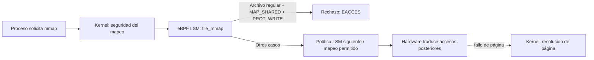

# Guion del desafío: control defensivo de `mmap()`

## Alcance y objetivo

Este proyecto demuestra una política defensiva en el kernel con eBPF LSM. El programa rechaza mapeos `MAP_SHARED` con permiso de escritura sobre archivos regulares. Permite `MAP_PRIVATE` con escritura porque sus cambios son privados y no se escriben en el archivo.

La demostración valida permisos en el alta del mapeo. No cifra datos ni inspecciona cada lectura o escritura que ocurre después del mapeo. Un acceso normal a una página ya presente en la tabla de páginas lo resuelve el hardware sin una llamada al kernel; un fallo de página sí transfiere el control al kernel. Por eso, un hook de `file_mmap` puede autorizar o rechazar el mapeo, pero no es un monitor de cada acceso posterior.

## 3.1 Definición del flujo de trabajo asistido por IA

### Exploración arquitectónica

La IA se utilizó para organizar los requisitos y distinguir los puntos de control disponibles:

1. `file_mmap` valida permisos al crear un mapeo respaldado por archivo.
2. Los fallos de página solo ocurren cuando una traducción o permiso requiere atención del kernel; no ocurren en cada acceso normal.
3. Las escrituras a páginas mapeadas y la sincronización (`msync`/`fsync`) tienen semánticas distintas. Observar una sincronización no equivale a inspeccionar todas las escrituras.

La revisión de las interfaces debe hacerse contra los encabezados BTF y la configuración del kernel donde se compila y ejecuta el programa. No se modifica la tabla de llamadas al sistema.

### Generación y verificación de código

La IA ayudó a bosquejar un programa eBPF LSM pequeño, un cargador en C y una prueba de integración. La revisión manual debe confirmar:

- que un rechazo previo de otro LSM se conserva;
- que el filtro solo decide sobre archivos regulares y mapeos compartidos con escritura;
- que un mapeo privado sigue funcionando y no altera el contenido respaldado por el archivo;
- que la compilación y carga se hacen en una máquina de laboratorio autorizada.

### Casos de prueba y PoC

La IA ayudó a definir pruebas con un archivo temporal creado por el propio proceso. Comprueban que el mapeo compartido escribible es rechazado cuando la política está cargada, también mediante 400 solicitudes desde varios hilos. Además, realizan escrituras privadas mientras otro hilo solicita `MADV_DONTNEED` sobre la región temporal y verifican que el archivo original no cambie.

No se creó un exploit de vulnerabilidad. Se usa una prueba de concepto defensiva y no destructiva, que valida la política sin intentar obtener privilegios, corromper archivos ni acceder a datos ajenos.

## 3.2 Metodología de ingeniería de prompts y verificación crítica

La siguiente tabla presenta prompts estructurados reconstruidos para documentar las etapas de trabajo; no es una transcripción literal de la conversación.

| Contexto | Rol solicitado | Restricción | Resultado esperado |
|---|---|---|---|
| Lecturas/escrituras a través de `mmap()` | Analista de arquitectura Linux | Diferenciar el alta del VMA de los accesos posteriores | Explicar qué puede y qué no puede observar un hook LSM |
| Política para archivos mapeados | Ingeniero eBPF defensivo | No modificar la syscall table ni crear una vía de explotación | Un filtro `file_mmap` que rechaza mapeos compartidos escribibles |
| Compatibilidad del código | Revisor de C/eBPF | Usar BTF, preservar rechazos previos y documentar requisitos | Código y Makefile con dependencias explícitas |
| Validación de la defensa | Ingeniero de pruebas | Usar solo un archivo temporal y no hacer cambios persistentes no deseados | Pruebas positivas y negativas reproducibles |

La IA puede ayudar a generar borradores, pero no demuestra por sí misma la seguridad. Los resultados se deben compilar, inspeccionar y ejecutar solo en un sistema de pruebas compatible.

## Arquitectura propuesta



El filtro de `src/mmap_guard.bpf.c` implementa la decisión. `src/loader.c` carga y adjunta el programa; `src/mmap_guard_test.c` ejercita la política con un archivo temporal. El cargador permanece activo durante la prueba y luego libera el enlace.

## Matriz de compensaciones

| Mecanismo | Rendimiento | Cobertura y seguridad | Limitaciones |
|---|---|---|---|
| eBPF LSM `file_mmap` | Bajo costo por decisión de mapeo; no se ejecuta en cada carga/almacenamiento | Puede impedir la creación de mapeos no permitidos | No observa accesos posteriores ni escrituras hechas con `write()` |
| Instrumentar fallos de página | Costo al ocurrir el fallo, no necesariamente en cada acceso | Útil para eventos de paginación y diagnóstico | Los accesos con PTE presente no producen un fallo por acceso |
| Inspeccionar eventos de dirtying/sincronización | Costo asociado a escritura diferida/sincronización | Ayuda a auditar persistencia | No sustituye una política de acceso ni garantiza inspeccionar cada modificación antes de ocurrir |
| Instrumentación de cada acceso de memoria | Puede ser muy costosa | Mayor visibilidad potencial | No es lo que ofrece un hook `mmap`; requiere mecanismos especializados |

La política de ejemplo prioriza una decisión sencilla y temprana. Al aplicarse a todos los archivos regulares, puede afectar aplicaciones que legítimamente usan mapeos compartidos escribibles.

## Implementación

### Archivos

- `src/mmap_guard.bpf.c`: filtro eBPF LSM.
- `src/loader.c`: cargador y adjuntador del programa.
- `src/mmap_guard_test.c`: prueba de integración con un archivo temporal.
- `scripts/test_guard.sh`: inicia la política durante un intervalo limitado y ejecuta la prueba.
- `Makefile`: compila el objeto BPF, genera el skeleton y enlaza los binarios.

### Requisitos

Se requiere `clang` con backend BPF, `bpftool`, `libbpf` y sus encabezados, `pkg-config`, `make`, GCC, BTF accesible en `/sys/kernel/btf/vmlinux`, y un kernel con BPF LSM habilitado. El soporte de BPF LSM existe desde Linux 5.7, pero la configuración y las funciones disponibles varían por distribución y versión. Esta muestra no garantiza compatibilidad universal con todas las versiones 5.x/6.x; verificar la configuración y compilar en el kernel objetivo.

En Ubuntu/Debian, las dependencias de compilación suelen instalarse con:

```sh
sudo apt install clang bpftool libbpf-dev libelf-dev zlib1g-dev pkg-config make gcc
```

En arquitecturas distintas de x86-64, define `BPF_ARCH` al valor que espera libbpf para esa arquitectura.

### Guion paso a paso para validar la implementación

Realiza la validación en una máquina virtual o equipo de laboratorio: mientras está cargado, el filtro afecta a los mapeos del sistema y puede impedir que algunas aplicaciones abran archivos con mapeo compartido escribible. No lo cargues en un sistema de producción.

#### 1. Comprobar el kernel activo

```sh
uname -r
grep -E '^(CONFIG_BPF|CONFIG_BPF_SYSCALL|CONFIG_BPF_LSM|CONFIG_DEBUG_INFO_BTF)=' \
  "/boot/config-$(uname -r)" 2>/dev/null || true
test -r /sys/kernel/btf/vmlinux && echo "BTF disponible"
cat /sys/kernel/security/lsm
```

Confirma que el kernel tiene BPF LSM y BTF habilitados, que existe `/sys/kernel/btf/vmlinux` y que la lista activa de LSM incluye `bpf`. La configuración puede estar en otra ubicación según la distribución. Tener BTF no significa por sí solo que el hook LSM esté habilitado.

#### 2. Instalar herramientas de compilación

En Ubuntu o Debian:

```sh
sudo apt update
sudo apt install clang bpftool libbpf-dev libelf-dev zlib1g-dev pkg-config make gcc
```

Esto instala el compilador con backend BPF, las herramientas para extraer BTF y generar el skeleton, y las bibliotecas/cabeceras de libbpf. En otras distribuciones, instala los paquetes equivalentes.

#### 3. Hacer una compilación limpia

Desde la raíz del proyecto:

```sh
make clean
make
```

`make clean` elimina los artefactos generados anteriores. `make` crea `build/vmlinux.h` desde el BTF del kernel activo, compila el filtro eBPF, genera el skeleton y enlaza el cargador y las pruebas C. Las opciones `-Wall`, `-Wextra` y `-Werror` convierten las advertencias de C en errores, así que una compilación exitosa no debe mostrar advertencias.

Si la compilación falla, revisa primero las dependencias, la ruta de BTF y que `BPF_ARCH` coincida con la arquitectura. No continúes con las pruebas de integración hasta que `make` termine con código cero.

#### 4. Ejecutar la prueba automatizada

```sh
sudo -v
make test
```

`sudo -v` valida los privilegios para que el script pueda iniciar el cargador con `sudo -n`. El script carga temporalmente la política durante 15 segundos y, mientras está activa, ejecuta `mmap_guard_test`. El enlace eBPF se libera cuando termina el cargador. Si la carga no está permitida, el script falla en lugar de presentar un falso éxito.

Se espera ver mensajes que indiquen que:

- el mapeo `MAP_SHARED` escribible fue rechazado con `EACCES`;
- 400 intentos concurrentes de crear ese mapeo fueron rechazados;
- el mapeo `MAP_PRIVATE` permitió una escritura privada sin alterar el archivo;
- escrituras privadas concurrentes con `MADV_DONTNEED` no persistieron en el archivo.

Las pruebas usan un archivo temporal y no modifican archivos del sistema. La prueba concurrente valida la política de alta del mapeo; la prueba con `MADV_DONTNEED` es una comprobación acotada de concurrencia, no una demostración matemática de ausencia de carreras en el kernel.

#### 5. Alternativa manual para observar la intercepción

En una terminal, carga el filtro durante 30 segundos:

```sh
sudo ./build/mmap_guard --seconds 30
```

Mientras aparezca `Política activa`, ejecuta en otra terminal:

```sh
./build/mmap_guard_test
```

El kernel consulta el hook `file_mmap` al solicitar cada mapeo. Si el archivo es regular y la solicitud combina `MAP_SHARED` con `PROT_WRITE`, el hook devuelve `EACCES` y el proceso no obtiene el mapeo. Los otros casos siguen la política de LSM del sistema. Al vencer los 30 segundos, el cargador se cierra y retira su enlace.

El cargador necesita privilegios para adjuntar el programa. La carga también puede estar restringida por lockdown, contenedores o políticas de seguridad. No deshabilites esas protecciones para forzar la prueba. Si cambias la duración, ejecútala en una sola terminal con el banco de pruebas en la otra y asegúrate de completar el test antes de que el cargador se cierre.

## Interpretación y límites

- El control protege la ruta de creación de mapeos compartidos escribibles, no todas las formas de modificar un archivo.
- Una aplicación con permisos de escritura todavía puede modificar el archivo con llamadas como `write()`.
- Un proceso autorizado puede leer datos a los que ya tiene acceso; la política no cifra memoria.
- `MAP_PRIVATE` puede aceptar escrituras privadas sin propagarlas al archivo.
- Esta muestra no pretende reemplazar controles de acceso POSIX, SELinux/AppArmor ni una política LSM de producción.
- No se incluye un exploit o PoC de vulnerabilidad. Las pruebas verifican únicamente la regla defensiva en un archivo temporal.

## Evidencia de verificación

- La prueba C se compiló con `-Wall -Wextra -Werror`; `--cow-only` confirmó que `MAP_PRIVATE` sobre un descriptor de solo lectura permite cambios privados sin modificar el archivo.
- `--race-only` completó 1000 solicitudes de `MADV_DONTNEED` concurrentes con escrituras privadas y confirmó que el contenido del archivo no cambió.

No se pudo compilar ni cargar el eBPF LSM en el entorno de elaboración: faltan `clang` y `libbpf`/sus encabezados. El sistema sí expone BTF y tiene `CONFIG_BPF_LSM=y`, pero la integración requiere instalar las dependencias y ejecutar las pruebas con privilegios en un entorno compatible.
